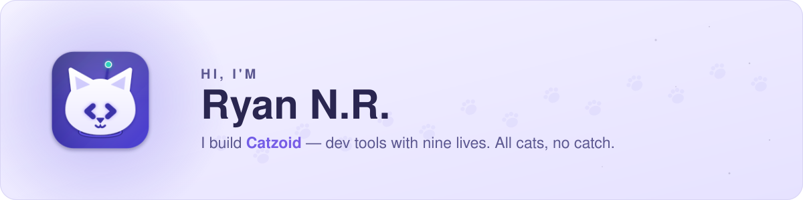
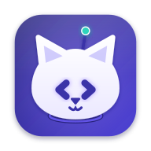
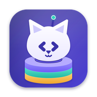
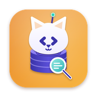
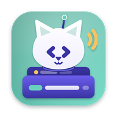
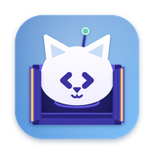
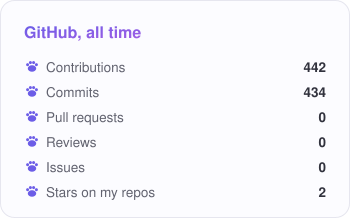
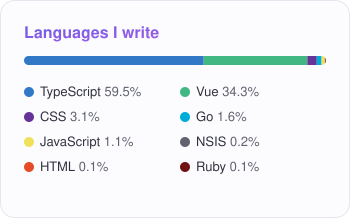
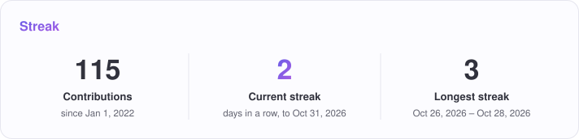
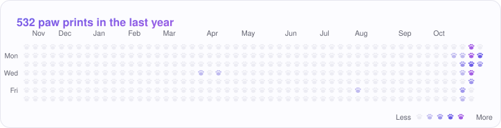

<picture>
  <source media="(prefers-color-scheme: dark)" srcset="assets/banner-dark.svg">
  
</picture>

  
  &nbsp;&nbsp;&nbsp;&nbsp;
  
  &nbsp;&nbsp;&nbsp;&nbsp;
  
  &nbsp;&nbsp;&nbsp;&nbsp;
  

 

### 🐾 About me

- Full-stack developer from Indonesia. I spend my days in **Laravel, Vue, TypeScript, Electron, Go** and **Astro**.
- I'm building **[Catzoid](https://catzoid.com)** — a family of free, open-source desktop tools for developers, each one a cat with its own job. I design them, write them (with Claude at my side), test them and ship them, including the website and its API.
- Handcrafting admin tables is how developers age overnight — so I wrote **[MrCatz DataTable](https://github.com/ryankucingg/mrcatz-datatables)** for Laravel + Livewire.
- I like tools that explain what went wrong in plain words, and apps that stay quiet when nothing is happening.

### 🐱 The litter

<table>
  <tr>
    <td align="center" width="20%">
      <a href="https://github.com/catzoidhub/DevCatz"> <b>DevCatz</b></a> 
      Local dev environment: every site on its own <code>https://*.localhost</code>, with runtimes, databases, storage, mail, tunnels and Docker.
    </td>
    <td align="center" width="20%">
      <a href="https://github.com/catzoidhub/DBCatz"> <b>DBCatz</b></a> 
      Database client for MySQL, PostgreSQL, SQLite, Redis, MongoDB and Elasticsearch, with production safety.
    </td>
    <td align="center" width="20%">
      <a href="https://github.com/catzoidhub/DialCatz"> <b>DialCatz</b></a> 
      API client for REST, GraphQL and WebSocket, with collections, scripts, Git and a self-hosted team den.
    </td>
    <td align="center" width="20%">
      <a href="https://github.com/catzoidhub/DoCatz"> <b>DoCatz</b></a> 
      The cat that carries the containers: a light Linux VM with every container on its own name. Still a kitten.
    </td>
    <td align="center" width="20%">
      <a href="https://github.com/catzoidhub/MCatzP"> <b>MCatzP</b></a> 
      One MCP door for your AI into the whole litter. One connection, every cat. Coming with DoCatz.
    </td>
  </tr>
</table>

All of them free and open source, built for macOS first, Windows on the way — <a href="https://github.com/catzoidhub">github.com/catzoidhub</a>

### 🧶 What I play with

  

### 📈 Paw prints

  <picture>
    <source media="(prefers-color-scheme: dark)" srcset="cards/stats-dark.svg">
    
  </picture>
  <picture>
    <source media="(prefers-color-scheme: dark)" srcset="cards/languages-dark.svg">
    
  </picture>

  <picture>
    <source media="(prefers-color-scheme: dark)" srcset="cards/streak-dark.svg">
    
  </picture>

  <picture>
    <source media="(prefers-color-scheme: dark)" srcset="cards/paws-dark.svg">
    
  </picture>

One paw print per day, darker where the cat was busier. Drawn every night by <a href="scripts/cards.mjs">a small script</a> in this repo — no third-party stats service.

 

  Dev tools with nine lives. All cats, no catch. &nbsp;🐾

